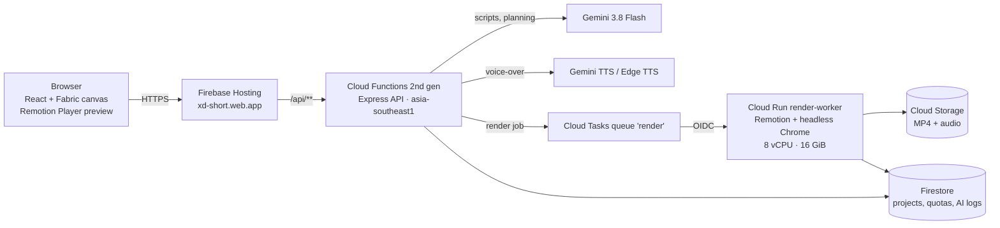

# XD-Short Studio

**From one idea to a finished 9:16 short video — script, scene design, voice-over, captions and render — built on Gemini and Google Cloud.**

Live prototype: **https://xd-short.web.app**
Theme: **Media, Content & Digital Experiences** — Google Cloud AI Builder Cup 2026

---

## The problem

Vietnamese creators, teachers and small businesses need a steady flow of short videos (TikTok, Reels, Shorts), but each one takes hours: writing a hook, structuring the story, designing every scene, recording a voice, timing captions and exporting. Generic "AI video" tools produce template slideshows that all look the same and often invent facts.

## What XD-Short does

1. **Type an idea** ("5 mistakes when saving money") and pick a length (15–60 s).
2. **Gemini writes the script and picks a scene template for every beat** from a designed scene library (hook → bridge → content → retention → climax → call to action).
3. **Review the script** scene by scene with a live preview rendered by the same engine as the final video.
4. **Choose a voice** (Gemini TTS or Edge TTS), captions are generated and timed to the voice.
5. **Edit on a canvas** (every layer is editable) and **export MP4** — rendered on Cloud Run.

## How we use Gen AI (Gemini)

| Where | Model | What it does |
|---|---|---|
| Script and scene planning | **Gemini 3.8 Flash** (`thinkingLevel: LOW` under a deadline) | Writes the voice-over and the on-screen text for each scene, and chooses one template per scene from the options of its role |
| Voice-over | **Gemini 3.1 Flash TTS** (Edge TTS as free fallback) | Narration per scene; scene length is fitted to the real audio duration |
| Style, hooks, Magic Fill | Gemini 3.8 Flash | Suggests a tone, rewrites hooks, fills data-driven widgets |

**AI does the creative work; code guarantees correctness.** Anything that can be computed is never left to the model:

- Numbers shown on screen (the "3" in "3 habits…", the number of steps, the answer tiles) are filled by the system from the plan, so the AI cannot contradict itself or invent statistics.
- Scene templates declare their pairing rules (a "Guess" retention scene must be answered by an "Answer" climax, which copies the question and choices; a "3 things" bridge must be closed by a summary with exactly 3 items). The prompt and the validator are generated from these declarations.
- Every plan is validated (word limits, list lengths, open loops closed before the CTA, placeholders). Errors are fed back to Gemini for one bounded retry inside a 50 s budget.
- Templates that would need real-world facts (cited statistics, personal results, viewer comments) are excluded until the user provides that source material.

## Architecture on Google Cloud



- **Firebase Hosting** serves the app; `/api/**` is rewritten to the **Cloud Functions** API.
- **Cloud Tasks → Cloud Run** renders inside the request (CPU billed per request, scales to zero). Max 3 parallel renders as a cost ceiling.
- **Firestore** stores projects, plan quotas and an AI generation log (model, tokens, latency, framework) used by the admin dashboard.
- **Cloud Storage** keeps rendered videos and generated audio.

## The Master scene library

One element type, `master-scene`, renders every designed template. A single layout function returns positioned boxes (wrapped text, shapes, icons, motion), and **the video (Remotion), the editor canvas (Fabric.js) and the element height formula all read the same boxes** — the three cannot drift apart. Automated audits check every template:

- DOM height in the real video render vs. the formula (21/21 cases, 0 px difference)
- Canvas bounds vs. the formula
- Text contrast on every palette and surface (dark, ivory, accent)

18 templates are live (3 per role); the design library defines 81. Adding a template is one declaration plus one layout; the planner, prompt, validator and editor inspector pick it up automatically.

## Tech stack

React 18 · TypeScript · Vite · Zustand · Fabric.js 6 · Remotion 4 · Express · Firebase (Hosting, Functions, Firestore, Storage, Auth) · Cloud Run · Cloud Tasks · Gemini API (`@google/genai`)

## Repository layout

```
src/
  components/AiWizardModal/   create-video modal (idea → script → voice)
  config/sceneRecipes.js      scene templates and their pairing rules
  config/masterSceneLayout.js shared layout for video, canvas and height
  config/videoPlan.js         planner: structure by length, constraints, validation
  remotion/                   video composition (frame-accurate rendering)
  utils/fabric/               editor canvas renderers
server/
  routes/ai/                  Gemini endpoints (master-video-plan, scene-design, TTS…)
  prompts/                    prompts generated from the template registry
  services/                   Gemini, TTS, render queue, AI logging
docs/RENDER_PIPELINE.md       render infrastructure (Cloud Tasks + Cloud Run)
```

## Run locally

```bash
npm install
cp .env.example .env          # add your Firebase web config
npm run dev                   # Vite on :5173, API + local renderer on :4000
```

Add a Gemini API key in **Settings → AI** inside the app (keys stay in the browser and are sent per request).

Quality gates:

```bash
npm run build                 # TypeScript + Vite + Remotion bundle
npm run test:unit             # planner, templates, element protocol
npm run test:server           # API and prompts
npm run test:widgets          # real-render DOM height audit
npm run test:fabric           # canvas parity and contrast audit
```

## Licence

All rights reserved. Published for evaluation in the Google Cloud AI Builder Cup 2026 only — see [LICENSE](LICENSE).
