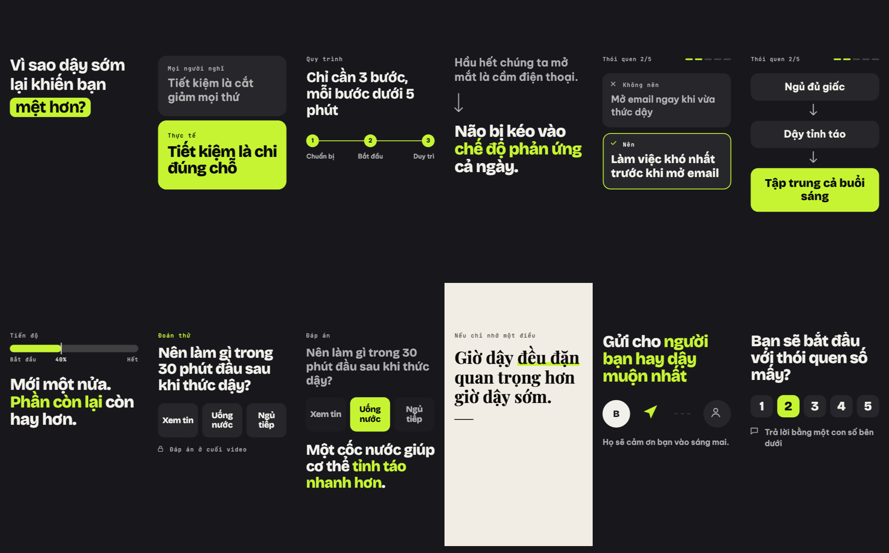
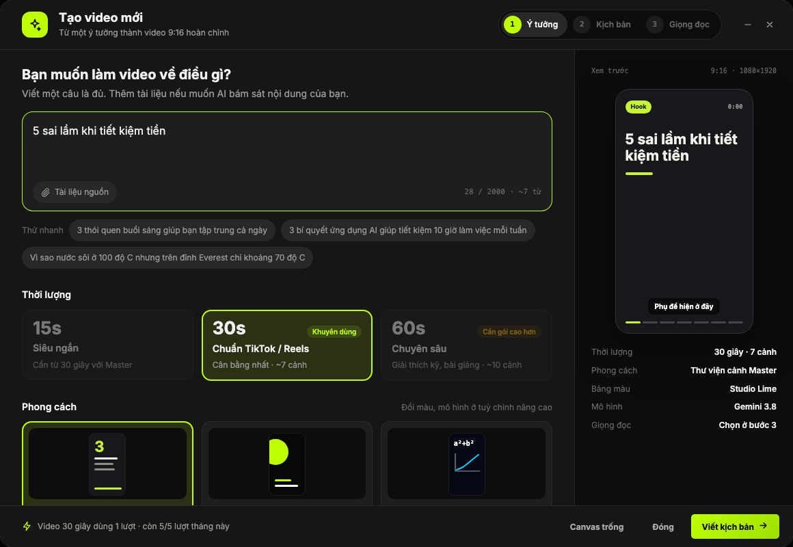
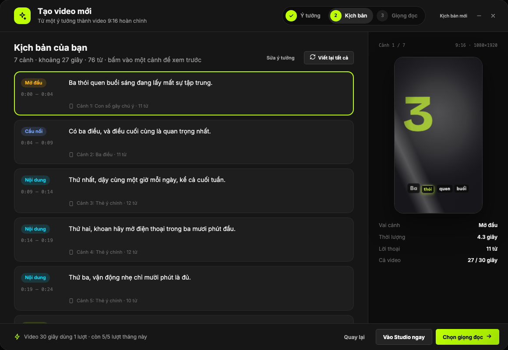
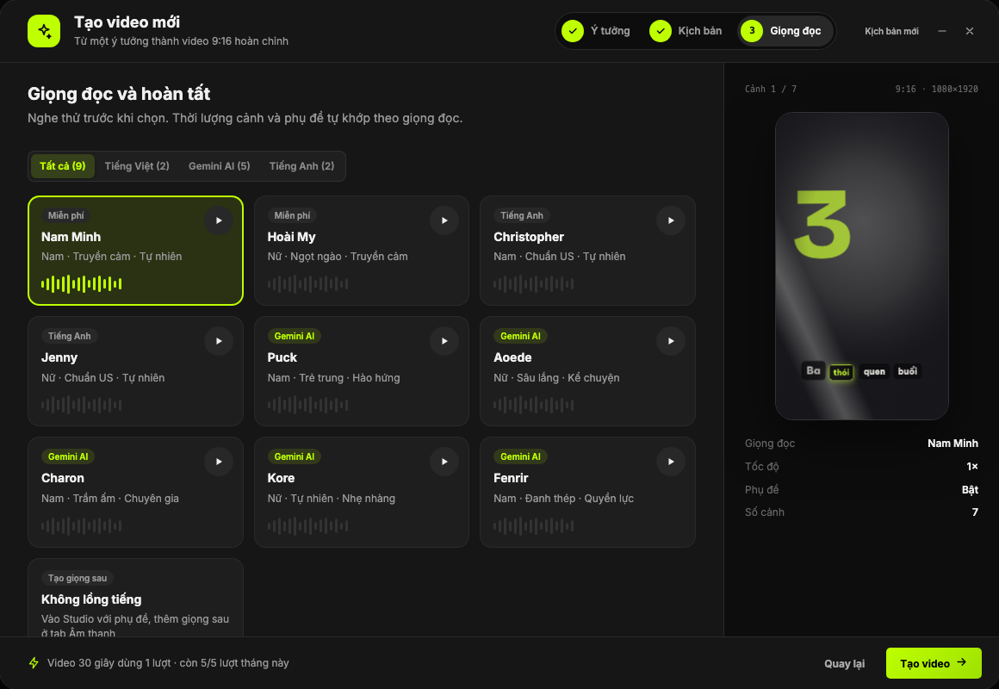
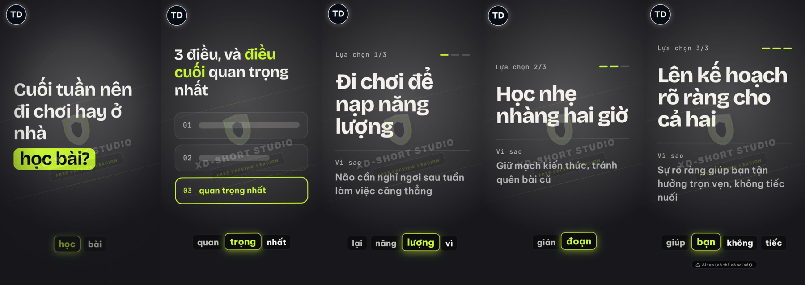
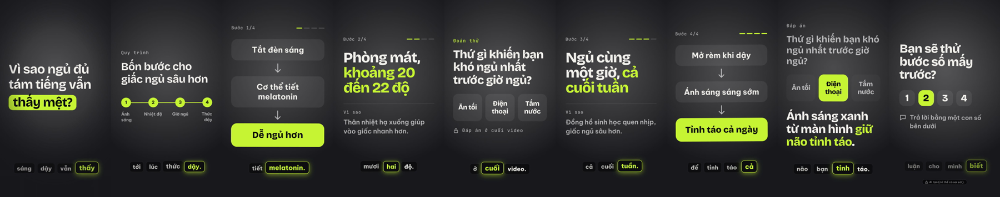
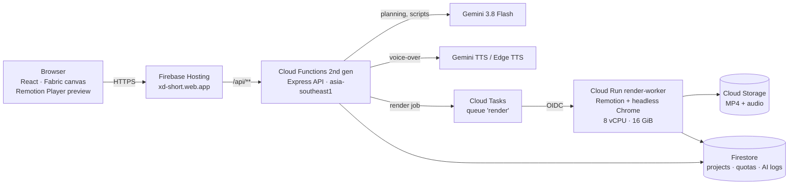

<div align="center">

# XD-Short Studio

### From one idea to a finished 9:16 short video — script, scene design, voice-over, captions and render — powered by Gemini on Google Cloud

**Google Cloud AI Builder Cup 2026 · Theme: Media, Content & Digital Experiences · Team X-DMAIC Lab**

| Live prototype | Demo video | Deck |
|---|---|---|
| **[xd-short.web.app](https://xd-short.web.app)** | _[link — under 3 min]_ | _[link — PDF]_ |

</div>



---

## Why

Short video is now the main channel for Vietnamese creators, teachers and small businesses, but every 30–60 second video still takes hours: a hook, a structure, a design for every scene, a voice recording, timed captions and an export. Existing "AI video" tools produce look-alike slideshows and often invent facts.

**XD-Short turns one sentence into an editable, designed short video in about a minute**, with a scene library made by designers and rules that stop the AI from making things up.

## How it works

| 1 · Idea | 2 · Script | 3 · Voice |
|---|---|---|
|  |  |  |
| Type one sentence, pick 15/30/60 s and a style. The scene count comes from the planner; plan limits and credits are shown up front. | Gemini writes every scene and picks its template. The preview column plays the **real scene** with the same engine as the export. | Pick a Gemini or Edge voice; scene length is fitted to the audio, captions follow each word. Then edit on the canvas and export MP4. |

A real run in the live app — one sentence, *"Weekend: go out or stay home and study?"*, became a 30 s video. AI-planned scenes: open-question hook, a three-option roadmap, one card per option (free-plan watermark visible):



Template showcase, 45 s, with a hand-written plan rendered by the same engine — open question → steps → cause chain → guess → answer → pick a number:



> The product UI is in Vietnamese, its target market. Code, documentation and this submission are in English.

## How we use Gemini

| Where | Model | Role |
|---|---|---|
| Script and scene planning | **Gemini 3.8 Flash** | Writes the voice-over and on-screen text of every scene and chooses one designed template per scene from the options of its role (hook, bridge, content, retention, climax, CTA) |
| Voice-over | **Gemini 3.1 Flash TTS** (Edge TTS as a free fallback) | Narration per scene; the timeline is re-timed to the real audio |
| Tone, hooks, Magic Fill | Gemini 3.8 Flash | Suggests a writing style, rewrites hooks, fills data widgets |

**The AI does the creative work; code guarantees correctness.** Whatever can be computed is never left to the model:

- **System-filled values.** Numbers on screen (the "3" in "3 habits…", the number of steps, the answer tiles) come from the plan, so the AI cannot contradict itself or invent statistics.
- **Declarative pairing rules.** Each template declares its rules — a *Guess* retention scene must be answered by an *Answer* climax, which copies the question and choices; a *3 things* bridge must be closed by a summary with exactly three items. The prompt and the validator are generated from these declarations.
- **Validate, then retry once.** Every plan is checked (word limits, list lengths, open loops closed before the CTA, placeholder text) and errors are fed back to Gemini for one bounded retry inside a 50 s budget, with `thinkingLevel: LOW` to stay inside the Hosting time limit.
- **No fabricated sources.** Templates that would need real-world facts (cited statistics, personal results, viewer comments) stay disabled until the user provides that material.

## Architecture



- **Firebase Hosting** serves the app and rewrites `/api/**` to the **Cloud Functions** API.
- **Cloud Tasks → Cloud Run** renders inside the request: CPU is billed per request, the service scales to zero, and at most three renders run in parallel as a cost ceiling.
- **Firestore** keeps projects, plan quotas and an AI generation log (model, tokens, latency, framework, cost) shown on the admin dashboard.
- **Cloud Storage** stores rendered videos and generated audio.

## One layout, three renderers

One element type, `master-scene`, draws every designed template. A single layout function returns positioned boxes (pre-wrapped text, shapes, icons, motion), and **the video (Remotion), the editor canvas (Fabric.js) and the element height formula all read the same boxes**, so the three cannot drift apart. Adding a template is one declaration and one layout; the planner, prompt, validator and editor inspector pick it up automatically.

## Measured

| | |
|---|---|
| Script plan for a 30 s video (Gemini 3.8 Flash, end to end) | valid on the first attempt in our test run |
| Render of a 30 s 720×1280 video (local renderer, same Remotion bundle as Cloud Run) | ~30 s |
| Templates live / designed | 18 / 81 (3 per role) |
| Real-render DOM height vs. formula | 21 / 21 cases, 0 px difference |
| Canvas bounds vs. formula | 21 / 21 cases |
| Text contrast audit | 0 issues on the default palette (dark and ivory surfaces) and four other palettes |

## Judging criteria at a glance

| Criterion | Where to look |
|---|---|
| **Technical merit & Gen AI (40%)** | Gemini planning with declarative constraints and generated prompts (`src/config/sceneRecipes.js`, `src/config/videoPlan.js`, `server/prompts/masterScenePrompt.js`); serverless render pipeline (`docs/RENDER_PIPELINE.md`); automated render audits (`tests/render/`) |
| **Problem alignment & impact (25%)** | One-sentence-to-video for Vietnamese creators and educators; STEM-ready widgets (formulas, graphs, molecules from PubChem) |
| **Innovation & creativity (25%)** | A designer-made scene library that the AI composes from, instead of free-form generation; open-loop pairing (guess → answer) as a retention mechanic |
| **User experience (10%)** | Three-step modal with a live preview of the real scene, plan-aware duration and credits, full canvas editing after generation |

## Run locally

```bash
npm install
cp .env.example .env          # Firebase web config
npm run dev                   # Vite on :5173, API + local renderer on :4000
```

Add a Gemini API key in **Settings → AI** inside the app (keys stay in the browser and are sent per request).

```bash
npm run build                 # TypeScript + Vite + Remotion bundle
npm run test:unit             # planner, templates, element protocol
npm run test:server           # API and prompts
npm run test:widgets          # real-render DOM height audit
npm run test:fabric           # canvas parity and contrast audit
```

## Repository map

```
src/components/AiWizardModal/   create-video modal (idea → script → voice)
src/config/sceneRecipes.js      scene templates and their pairing rules
src/config/masterSceneLayout.js shared layout for video, canvas and height
src/config/videoPlan.js         planner: structure by length, constraints, validation
src/remotion/                   video composition (frame-accurate rendering)
src/utils/fabric/               editor canvas renderers
server/routes/ai/               Gemini endpoints (master-video-plan, scene-design, TTS…)
server/prompts/                 prompts generated from the template registry
docs/RENDER_PIPELINE.md         render infrastructure (Cloud Tasks + Cloud Run)
```

## Roadmap

- Shortlist 3–4 templates per scene with a small, fast Gemini call so the prompt stays small as the library grows to 81 templates and beyond
- Log the chosen templates, avoid repeats across a creator's videos, and score plans on a fixed topic set
- Template versions so saved projects never change when a template is revised; visual regression against the design artboards
- Swap a scene's template inside the editor

## Team X-DMAIC Lab

| Member | Role |
|---|---|
| Võ Linh Tĩnh | Team leader |
| Vương Thị Khánh Nhung | Team member |

## Licence

Proprietary, source-available for evaluation only. Viewing is allowed; copying, modifying, deploying, redistributing or using this code to train AI models is not. See [LICENSE](LICENSE).

Copyright © 2026 Võ Linh Tĩnh (TinhVoLab) and team X-DMAIC Lab. All rights reserved.
